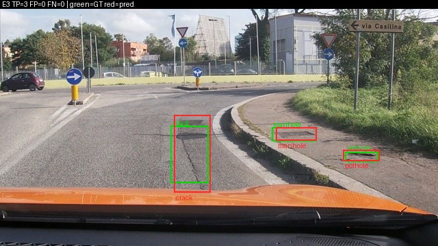
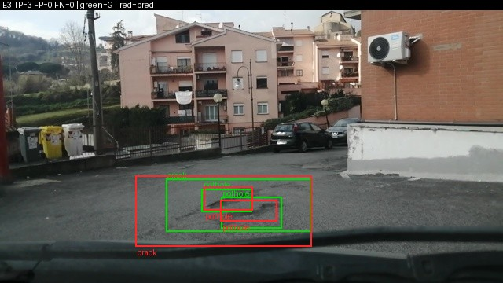
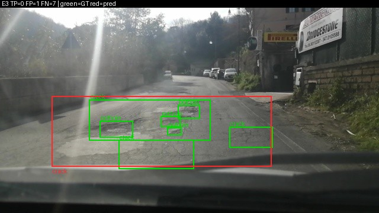
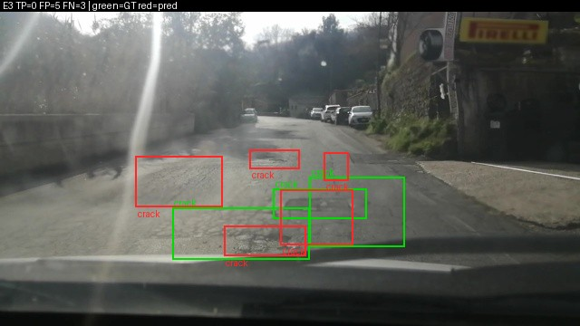
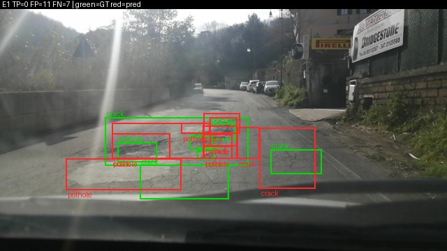

Họ tên: Đoàn Anh Quân
`dataset_version`: d10-21e4070301

Mọi số trong bảng lấy từ `report/evidence/*.json` (do `scripts/score.py` sinh ra, chạy trên Kaggle T4, seed 42, mỗi setup **một lần chạy**). Các số phân tích thêm (bootstrap ghép cặp, bẫy thang toạ độ, thống kê box) tính từ `report/predictions/*.jsonl` bằng `python -m d10.analyze`; chúng không nằm trong file evidence và được ghi rõ ở từng chỗ.

## Bảng tổng hợp (số của bạn, lấy từ `report/evidence/*.json`)

| Mã | Setup | Tham số huấn luyện | VRAM đỉnh (GB) | Phút | F1 | CI95 | FP/ảnh | F1 pothole | F1 crack | F1 manhole |
|---|---|---|---|---|---|---|---|---|---|---|
| E0 | zero-shot | 0 | – | – | 0.077 | 0.055–0.103 | 1.18 | 0.112 | 0.021 | 0.172 |
| E1 | LoRA LLM | 33,030,144 | 6.38 | 42.34 | 0.263 | 0.228–0.304 | 1.35 | 0.148 | 0.190 | 0.545 |
| E2 | + projector | 142,135,296 | 8.07 | 42.92 | 0.304 | 0.269–0.340 | 1.25 | 0.172 | 0.226 | 0.592 |
| E3 | + LoRA ViT | 148,426,752 | 8.25 | 50.94 | 0.421 | 0.378–0.465 | 0.95 | 0.288 | 0.327 | 0.717 |
| E4 | `data_size` = 0.1 (142 ảnh train), nền E3 | 148,426,752 | 7.70 | 50.47 | 0.285 | 0.249–0.321 | 1.53 | 0.161 | 0.227 | 0.546 |
| E4 | `data_size` = 1.0 (1.422 ảnh, chính là E3) | 148,426,752 | 8.25 | 50.94 | 0.421 | 0.378–0.465 | 0.95 | 0.288 | 0.327 | 0.717 |

`parse_valid_rate`: E0 0.942 · E1 1.000 · E2 1.000 · E3 0.997 · E4(0.1) 1.000. VRAM đỉnh là `torch.cuda.max_memory_allocated` (bộ nhớ đã cấp phát, chưa tính phần PyTorch giữ chỗ). Thời gian là thời gian vòng huấn luyện 300 bước, không gồm nạp model và suy luận. Nhật ký từng 10 bước: `report/logs/<mã>/train_log.jsonl`, đồ thị loss: `report/figures/loss.png`.

E5 (GRPO) **chưa có kết quả**: lần chạy thử trên GPU lỗi (xem "Nhìn lại"), nên không có `e5.json`.

## 10 câu hỏi (trả lời bằng **số của bạn**, không chép lại tài liệu)

### Câu 1 — Kiến trúc: ViT, projector và LLM của Qwen3-VL-4B có bao nhiêu tham số mỗi khối, và E1/E2/E3 mỗi cái cập nhật khối nào?

Tôi đếm từ header safetensors của checkpoint `Qwen/Qwen3-VL-4B-Instruct` (tổng 4,437,815,808 tham số):

| Khối | Tham số |
|---|---|
| ViT: 24 block + patch/pos embed | 306,242,560 |
| Projector `visual.merger` | 27,271,680 |
| Projector `visual.deepstack_merger_list` (3 merger cho lớp 5, 11, 17) | 81,833,472 |
| LLM: 36 lớp decoder | 3,633,511,936 |
| LLM: embedding (dùng chung trọng số với `lm_head`) | 388,956,160 |

Projector cộng lại là 109,105,152, khớp đúng `projector_params` trong `report/logs/e2/run.json`.

- **E1**: chỉ LoRA r=16 trên 252 module của LLM (36 lớp × 7: q, k, v, o, gate, up, down) = 33,030,144 tham số, tức 0.74% model. ViT và projector đóng băng.
- **E2**: E1 + toàn bộ projector ở float32 = 33,030,144 + 109,105,152 = 142,135,296.
- **E3**: E2 + LoRA trên 96 module của ViT (24 block × 4: qkv, proj, fc1, fc2), tổng 348 module LoRA; LoRA tăng lên 39,321,600 (ViT góp 6,291,456), tổng 148,426,752.

Trọng số gốc của ViT và LLM không đổi ở cả ba setup; chỉ adapter và (E2/E3) projector được cập nhật.

### Câu 2 — E0: `parse_valid_rate` bằng bao nhiêu, và hai lỗi phổ biến nhất của model gốc là gì (kèm một ví dụ output thô)?

`parse_valid_rate` = 0.942 (18/311 ảnh hỏng JSON). F1 = 0.077, precision 0.094, recall 0.065.

Model gốc **không sai định dạng và không sai thang**: không output nào bọc ```` ```json ````, không có nhãn lạ, mọi toạ độ ≤ 1000, và mean IoU của các cặp khớp là 0.619. Hai lỗi chính là:

1. **Box "vết nứt" khổng lồ, bịa theo mặt đường.** 71/404 box dự đoán rộng ≥ 90% khung hình, 30 box phủ hơn 25% diện tích (box thật có diện tích trung vị dưới 2%). Lớp crack chỉ có 6 TP trên 255 FP (precision 0.023). 219/311 ảnh trả đúng một box. Ví dụ ảnh `vlcsnap-2025-02-18-23h13m36s544`:
   `[{"label": "crack", "bbox_2d": [0, 324, 1000, 800]}]`
   (E1 trên cùng ảnh trả `[428,550,581,783]`).
2. **Lát một vết nứt thành chuỗi box nhỏ nối đuôi đến khi hết token.** 17/18 output hỏng bị cắt giữa chừng ở `max_new_tokens=256`, đều dừng ở box thứ 8, ví dụ:
   `[{"label": "crack", "bbox_2d": [485, 457, 520, 478]}, {"label": "crack", "bbox_2d": [520, 478, 550, 500]}, {"label": "crack", "bbox_2d": [550, 497, 580, 520]}, ...`
   `score.py` coi cả ảnh là không có dự đoán khi JSON bị cắt.

Ảnh minh hoạ: `report/figures/E0_bad_1.jpg` (7 box crack ngang toàn khung, TP=0 FP=7 FN=3).

### Câu 3 — Thang 0–1000: nếu chấm output theo pixel (hoặc ngược lại) thì F1 ra sao và vì sao? Bạn đã kiểm chứng điều này thế nào?

F1 về **0.000 ở cả hai chiều**, trong khi `parse_valid_rate` không đổi (JSON vẫn hợp lệ, nên lỗi này không lộ ra ở tỉ lệ parse):

| Kiểm chứng (tính lại từ `report/predictions`) | F1 |
|---|---|
| E1 (output thang 0–1000) chấm đúng `--coord norm1000` | 0.263 |
| E1 chấm nhầm `--coord pixel` | 0.000 (valid 1.000) |
| E3 chấm nhầm `--coord pixel` | 0.000 (valid 0.997) |
| E3 đổi output sang pixel rồi chấm như 0–1000 | 0.000 |
| E3 đổi output sang pixel rồi chấm `--coord pixel` | 0.421 (đúng bằng gốc) |

Vì sao: ảnh 640×360 nên một điểm trên thang 0–1000 khác toạ độ pixel 1.5625 lần theo x và 2.78 lần theo y. Box bị co hoặc giãn và trượt đi từng ấy lần; với box nhỏ (diện tích trung vị 0.4–2% khung) thì không còn cặp nào đạt IoU ≥ 0.5.

Tôi cũng dùng phép thử này để xác định model gốc trả thang nào: E0 chấm theo pixel cho F1 0.000, chấm theo 0–1000 cho 0.077, tức Qwen3-VL gốc đã trả thang 0–1000 và lỗi của E0 không phải lỗi thang. Phía nhãn, tôi kiểm phép đổi YOLO → JSON bằng cách quy ngược về pixel trên toàn bộ 3,515 box train: sai số lớn nhất 0.320 px (49 box có mép vượt khung được kẹp vào [0, 1000]).

### Câu 4 — Mask loss: vì sao chỉ tính loss trên phần trả lời? Điều gì xảy ra nếu tính trên cả prompt và token ảnh?

Thứ model cần học là sinh JSON đáp án khi đã có ảnh và prompt. Prompt là chuỗi cố định, giống hệt nhau ở mọi ví dụ; 220 vị trí ảnh là token giữ chỗ `<|image_pad|>` (embedding thật do ViT chèn vào), dự đoán "token kế tiếp" ở đó không có ý nghĩa.

Số của tôi cho ví dụ đã in trong notebook (1 box): chuỗi dài 358 token, chỉ **31 token** có `labels != -100`; giải mã đúng ra `[{"label":"manhole","bbox_2d":[105,639,205,689]}]<|im_end|>`. Nếu không mask, 327/358 ≈ 91% số vị trí tính loss là prompt và token ảnh. Hệ quả:

- Loss trung bình bị chi phối bởi việc đoán lại prompt cố định và 220 token giữ chỗ; gradient của phần toạ độ bị pha loãng khoảng 11 lần với ảnh 1 box.
- Model nhanh chóng thuộc lòng prompt, loss tụt rất nhanh và trông như hội tụ, nhưng phần giảm đó không nói gì về chất lượng box.
- 33M tham số LoRA bị dùng để học việc vô ích (đoán `<|image_pad|>` kế tiếp).

Tôi **không chạy** thí nghiệm bỏ mask, nên các hệ quả trên là lập luận chứ chưa đo. Điều tôi đã kiểm là mask đúng: `encode_example` raise lỗi nếu chuỗi prompt không phải tiền tố chính xác của chuỗi đầy đủ, và notebook assert phần nhãn giải mã ra đúng đáp án + `<|im_end|>`.

### Câu 5 — Vì sao không thể huấn luyện đầy đủ projector nếu ViT bị lượng tử hoá 4-bit, và bạn đã xử lý thế nào? Vì sao projector phải ở float32?

**Vì sao không huấn luyện được.** Lớp 4-bit NF4 không lưu trọng số dạng số thực mà lưu mã 4 bit (16 mức cho mỗi trọng số). Tensor đó không phải kiểu float nên không thể bật gradient, và kể cả tính được gradient thì một bước cập nhật nhỏ cũng mất khi làm tròn về 16 mức.

Tôi gặp đúng lỗi này. Cấu hình theo GUIDE, `llm_int8_skip_modules=["visual", "lm_head"]`, **không giữ được ViT ở fp16** với `transformers==5.19.0`: thư viện so pattern với phần *đầu* tên module, mà ViT tên là `model.visual...`, nên `"visual"` không khớp gì và toàn bộ ViT kể cả projector bị lượng tử hoá âm thầm. Lần chạy thử E3 dừng ở `p.requires_grad = True` với lỗi `only Tensors of floating point and complex dtype can require gradients`.

**Xử lý.** Đổi pattern thành `"model.visual"` (kiểm lại bằng chính hàm `should_convert_module` của thư viện), và thêm chốt trong `load_base`: raise nếu còn tensor nào của ViT hay `lm_head` không phải float. Dấu vết trong số đo: VRAM đỉnh của lần chạy thử E1 (2 bước) tăng từ 4.74 GB khi ViT bị 4-bit lên 5.31 GB khi ViT ở fp16.

**Vì sao float32.** Hai lý do, cả hai đều về độ phân giải số:

- `GradScaler` từ chối unscale gradient fp16, nên tham số được tối ưu trực tiếp phải là float32.
- fp16 chỉ có 10 bit phần định trị, bước nhỏ nhất quanh giá trị w cỡ w/1000. Bước cập nhật của AdamW cỡ lr; lr của tôi đi từ 2e-4 về 0 theo cosine, nên càng về cuối càng nhiều cập nhật nhỏ hơn nửa bước lưới của fp16 và bị làm tròn mất.

Trong code, mọi tham số có `requires_grad` (LoRA và projector) được ép về float32; phần đóng băng vẫn ở fp16/4-bit và forward chạy trong `autocast` fp16.

### Câu 6 — Split theo phiên quay: vì sao chia ngẫu nhiên sẽ cho F1 cao giả? Số ảnh và số box từng lớp ở mỗi split là bao nhiêu?

Ảnh là frame cắt từ video, hai frame liền nhau gần như trùng: cùng ổ gà, cùng góc nhìn, lệch vài pixel. Chia ngẫu nhiên sẽ đưa frame gần trùng của cùng một đoạn đường vào cả train lẫn test; model chỉ cần nhớ đoạn đường đã thấy là có điểm, và F1 đo khả năng nhớ chứ không đo khả năng tổng quát sang đường mới. Chia theo phiên quay (ngày + giờ trong tên file) giữ nguyên cả phiên trong một split.

| Split | Phiên | Ảnh | Box | pothole | crack | manhole |
|---|---|---|---|---|---|---|
| train | 13 | 1,422 | 3,515 | 1,074 | 1,750 | 691 |
| val | 2 | 276 | 639 | 66 | 470 | 103 |
| test | 3 | 311 | 583 | 121 | 299 | 163 |

Notebook assert không phiên nào nằm ở hai split; không ảnh nào trống box. Lưu ý về test: 213/311 ảnh đến từ một phiên duy nhất (`vlc-2025-02-18-23`), 83 từ phiên thứ hai, 15 từ phiên thứ ba. Phân bố lớp cũng lệch giữa các split (pothole chiếm 31% box train nhưng 21% box test và 10% box val).

Tôi **không chạy** thí nghiệm chia ngẫu nhiên nên không có con số F1 "cao giả" của riêng mình. Bằng chứng gián tiếp tôi có là E4: với 142 ảnh train, loss huấn luyện xuống 0.0149 (thuộc lòng tập train) trong khi F1 test chỉ 0.285, tức model này nhớ rất tốt những gì đã thấy, đúng loại năng lực mà chia ngẫu nhiên sẽ thưởng điểm.

### Câu 7 — So sánh E1/E2/E3: mở projector và LoRA trên ViT có đáng không (F1, CI95, VRAM, thời gian)?

| Bước | ΔF1 | CI95 của ΔF1 (bootstrap ghép cặp) | ΔVRAM | Δthời gian |
|---|---|---|---|---|
| E1 → E2 (mở projector) | +0.040 | +0.007 … +0.073 | +1.69 GB | +0.6 phút |
| E2 → E3 (thêm LoRA ViT) | +0.117 | +0.074 … +0.159 | +0.18 GB | +8.0 phút |
| E1 → E3 | +0.158 | +0.116 … +0.198 | +1.87 GB | +8.6 phút |

(ΔF1 ghép cặp: resample cùng 311 ảnh cho cả hai setup, 2,000 lần, tính từ `report/predictions`.)

- **LoRA trên ViT đáng nhất.** E3 đạt 0.421 so với 0.304 của E2; hai khoảng tin cậy riêng (0.378–0.465 và 0.269–0.340) không chồng nhau. Cả ba lớp đều tăng, precision tăng từ 0.310 lên 0.443 và FP/ảnh giảm từ 1.25 xuống 0.95. Giá phải trả là 8 phút (gradient phải đi ngược qua 24 block ViT) và gần như không thêm VRAM. Cách hiểu của tôi: vật thể rất nhỏ (ổ gà trung vị 46×22 px), đặc trưng thị giác đóng băng không đủ phân giải cho chúng, nên phải sửa chính ViT.
- **Mở projector đáng ở mức vừa phải.** +0.040 F1, hai khoảng tin cậy riêng chồng nhau (0.228–0.304 và 0.269–0.340) nhưng khoảng ghép cặp không chứa 0. Chi phí là +1.69 GB VRAM (109M tham số float32 cùng trạng thái AdamW) và 4.3 lần số tham số huấn luyện, gần như không thêm thời gian.
- Setup đáng đồng tiền nhất trên T4 là **E3**: 8.25 GB vẫn dư xa giới hạn 16 GB, thêm 20% thời gian so với E1 để được F1 gấp 1.6 lần.

Giới hạn: mỗi setup chạy một seed, nên tôi không biết độ dao động giữa các lần huấn luyện. Chênh +0.040 của E2 đủ nhỏ để có thể đổi dấu ở seed khác; chênh +0.117 của E3 thì khó.

### Câu 8 — Tập test có 311 ảnh: khoảng tin cậy rộng thế nào, và điều đó giới hạn kết luận so sánh các setup ra sao?

CI95 của F1 rộng khoảng **0.07–0.09** (±0.04): E1 0.228–0.304 (rộng 0.076), E2 0.269–0.340 (0.071), E3 0.378–0.465 (0.087), E4-0.1 0.249–0.321 (0.072). So với giá trị F1 thì đó là ±10–15%.

Hệ quả cho kết luận:

- Chênh lệch dưới khoảng 0.04–0.05 F1 không tách được chỉ bằng CI riêng: E1/E2/E4-0.1 (0.263, 0.304, 0.285) có khoảng chồng nhau. Kết luận còn đứng vững là "E3 hơn cả ba" và "mọi setup có huấn luyện hơn E0" (E1 − E0 = +0.186, ghép cặp +0.151 … +0.222).
- So ghép cặp trên cùng ảnh nhạy hơn (nhờ đó mới thấy E2 > E1), nhưng vẫn chỉ nói về 311 ảnh này.
- **Khoảng tin cậy thật còn rộng hơn con số trên.** Bootstrap resample từng ảnh như thể chúng độc lập, trong khi test chỉ có 3 phiên quay và 213 ảnh thuộc cùng một phiên, các frame liền nhau gần như trùng. Số mẫu độc lập thực tế nhỏ hơn 311 nhiều; nếu resample theo phiên thì gần như không ước lượng được gì với 3 phiên. Vì vậy kết quả mô tả "ba đoạn đường này", chưa phải mọi con đường.
- F1 từng lớp còn bấp bênh hơn: pothole chỉ có 121 box test, E3 đúng 32 box; lệch vài box đã đổi F1 cả phần trăm.
- CI không bao gồm dao động do seed huấn luyện (mỗi setup một lần chạy).

### Câu 9 — Phân tích lỗi theo lớp: lớp nào kém nhất và vì sao (kích thước box, số mẫu, ngữ nghĩa)? Kèm ảnh minh hoạ.

Với E3 (setup tốt nhất): **pothole kém nhất** (F1 0.288, P 0.317, R 0.264; 32 TP / 69 FP / 89 FN), rồi **crack** (0.327; 98 / 202 / 201), **manhole** tốt nhất (0.717; 104 / 23 / 59). Thứ tự này giống nhau ở E1, E2, E3.

| Lớp (test) | Box | Diện tích trung vị | Kích thước trung vị |
|---|---|---|---|
| pothole | 121 | 0.42% khung | 46 × 22 px |
| crack | 299 | 1.98% khung | 89 × 55 px |
| manhole | 163 | 0.67% khung | 63 × 24 px |

- **Pothole: nhỏ và lẫn ngữ nghĩa với crack.** Box nhỏ nhất (46×22 px, tương đương khoảng 1.4 × 0.7 token ảnh vì mỗi token phủ 32×32 px), nên lệch vài pixel đã rớt IoU 0.5. Trong các box E3 định vị được (IoU ≥ 0.5 bất kể nhãn) nhưng sai nhãn, cặp nhiều nhất là pothole bị gọi thành crack (12/33). Ít mẫu test nhất nên số đo cũng nhiễu nhất.
- **Crack: lỗi về phạm vi box chứ không phải kích thước.** Crack là lớp to nhất và nhiều mẫu nhất (1,750 box train) mà F1 vẫn thấp, vì "một vết nứt" không có ranh giới rõ: người gán nhãn chia một mảng nứt thành nhiều box, model gộp thành một box lớn, hoặc ngược lại. Ảnh `E3_bad_1.jpg`: nhãn có 7 box, E3 trả một box crack trùm cả mảng → TP=0, FP=1, FN=7 dù model nhìn đúng chỗ. Kiểu lệch này tạo ra cả FP lẫn FN cùng lúc (crack có 202 FP và 201 FN).
- **Manhole: hình dạng và ranh giới rõ**, precision 0.819; lỗi chủ yếu là bỏ sót (59 FN).
- **Định vị lỏng là lỗi chung.** Recall của E3 theo ngưỡng IoU (cùng nhãn): 0.662 ở IoU ≥ 0.1, 0.530 ở ≥ 0.3, 0.401 ở ≥ 0.5, 0.197 ở ≥ 0.7. Tức 13% số box thật đã được tìm thấy với IoU 0.3–0.5 nhưng không được tính điểm.

Ảnh minh hoạ (xanh = nhãn đúng, đỏ = dự đoán, số TP/FP/FN ghi trên ảnh):

| Ảnh | Nội dung |
|---|---|
|  | E3 đúng cả 3 lớp trong một ảnh: crack, manhole, pothole (TP=3) |
|  | E3 đúng crack lớn và hai pothole lồng bên trong (TP=3) |
|  | E3 gộp 7 box nhãn thành một box crack lớn (TP=0, FP=1, FN=7) |
|  | E3 định vị lệch trên mặt đường hư hại dày, ngược sáng (TP=0, FP=5, FN=3) |
|  | E1 trên cùng cảnh: 11 box sai, nhiều box chồng nhau (TP=0, FP=11, FN=7) |
|  | E0: 7 box "crack" ngang toàn khung hình (TP=0, FP=7, FN=3) |

Các ảnh khác: `report/figures/E{0,1,3}_{good,bad}_*.jpg`.

### Câu 10 — E4: bạn đổi biến nào, kết quả thế nào, và kết luận có đáng tin không?

**Biến đổi: `data_size`** (số ảnh train), trên nền E3. Mọi thứ khác giữ nguyên: cùng config E3, cùng seed, cùng 300 bước × 8 ảnh. Giá trị 1.0 chính là lần chạy E3 (chấm lại cùng file dự đoán); giá trị 0.1 là 142 ảnh lấy ngẫu nhiên cố định từ 1,422 ảnh train.

| | 10% (142 ảnh) | 100% (1,422 ảnh) |
|---|---|---|
| F1 | 0.285 | 0.421 |
| CI95 | 0.249–0.321 | 0.378–0.465 |
| Precision / Recall | 0.270 / 0.302 | 0.443 / 0.401 |
| FP/ảnh | 1.53 | 0.95 |
| Loss train cuối | 0.0149 | 0.5045 |

Chênh +0.136 F1, CI95 ghép cặp +0.094 … +0.179, hai khoảng riêng không chồng nhau. Kết luận **"thêm dữ liệu giúp rõ rệt trên tập test này" là đáng tin**: chênh lệch lớn gấp khoảng ba lần nửa độ rộng CI.

Hai điều cần nói rõ để không kết luận quá:

- Vì giữ nguyên 300 bước, model 10% thấy mỗi ảnh khoảng 17 lần (so với 1.7 lần), loss về 0.0149 tức thuộc lòng tập train, và nó bịa nhiều box hơn (2.10 box/ảnh so với 1.70). Thí nghiệm đo "ít dữ liệu ở cùng ngân sách tính toán", không tách riêng được hiệu ứng thiếu dữ liệu khỏi hiệu ứng lặp lại quá nhiều.
- Chỉ có hai điểm (10% và 100%), một seed, một tập con 142 ảnh. Tôi không biết đường cong ở giữa, cũng không biết 100% đã bão hoà chưa.

Một quan sát phụ: E3 huấn luyện trên 142 ảnh (0.285) ngang E1 huấn luyện trên 1,422 ảnh (0.263; chênh +0.022, CI ghép cặp −0.020 … +0.060, tức không phân biệt được).

Hạn chế về quy trình: nền của E4 được chọn là setup có F1 **test** cao nhất, tức có chọn lựa trên tập test. Với chênh lệch E3–E2 lớn như trên thì chọn bằng val nhiều khả năng cũng ra E3, nhưng tôi chưa chấm val để xác nhận.

## Nhìn lại

**Lỗi tôi gặp mà công cụ chấm không bắt được**

- **ViT bị lượng tử hoá âm thầm** (câu 5). Với pattern `"visual"` của GUIDE, E0 và E1 vẫn chạy và vẫn ra evidence hợp lệ; `check_submission.py` không có cách nào biết ViT đang ở 4-bit. Chỉ lộ ra khi E2/E3 cần bật gradient cho projector.
- **`score.py` loại cả ảnh khi JSON bị cắt hoặc có một box suy biến.** Một output dài bị cắt ở `max_new_tokens` mất toàn bộ box đúng phía trước (17 ảnh ở E0, 1 ảnh ở E3 khi model lặp box pothole 18 lần đến hết 512 token). Vì vậy tôi dùng 512 token cho model đã huấn luyện (ảnh nhiều box nhất của train có 13 box, khoảng 29 token mỗi box) và kẹp nhãn để không bao giờ dạy model box có chiều rộng 0.
- **49 box train có mép vượt ra ngoài khung hình**, và một box crack có kích thước 0 trong nhãn gốc.
- **Nhãn crack không nhất quán về độ chi tiết** (câu 9): cùng một mảng nứt có thể là 1 box hoặc 7 box. F1@IoU0.5 phạt nặng kiểu sai lệch này dù model nhìn đúng vùng.
- `tests/test_configs_and_docs.py` có một test yêu cầu `REPORT.md` còn nguyên chuỗi giữ chỗ của mẫu, nên test đó của đề fail sau khi điền báo cáo (67 test còn lại pass, 1 skip).

**Môi trường**

- Kaggle cài sẵn `torchao` 0.10 mà `peft` 0.21.2 từ chối khi gắn LoRA lên `nn.Linear` thường (ViT fp16 ở E3). Code bỏ qua nhánh torchao của peft.
- **E5 chưa chạy được.** `trl` 1.9.2 tự ép adapter của model lượng tử hoá sang bf16, còn `GradScaler` fp16 không hỗ trợ bf16 (`_amp_foreach_non_finite_check_and_unscale_cuda not implemented for 'BFloat16'`). Hàm reward IoU và 15 unit test của nó đã xong (`d10/reward.py`, `tests_d10/`), code GRPO đã sửa (ép adapter về float32 sau khi tạo trainer) nhưng bản sửa **chưa được kiểm chứng trên GPU**, nên tôi không báo cáo số nào cho E5.

**Điều tôi chưa hiểu / chưa làm**

- Chưa đo dao động giữa các seed, nên chưa biết +0.040 của E2 so với E1 có lặp lại không.
- Chưa tách được vì sao LoRA trên ViT giúp nhiều đến vậy: do đặc trưng thị giác tốt hơn cho vật nhỏ, hay chỉ do có thêm 6.3M tham số ở đúng chỗ. Cần thử LoRA ViT mà không mở projector.
- Chưa có thí nghiệm chia ngẫu nhiên (câu 6) và bỏ mask loss (câu 4); hai câu đó tôi trả lời bằng lập luận.
- Chưa chấm trên val; mọi lựa chọn (nền của E4) đang dựa vào test.
